# Construire le concierge DevFest en direct avec Google CX Agent Studio

Dans cet atelier, vous allez construire un assistant qui répond aux questions des participants du DevFest Paris !

En 90 minutes, vous déployez un système conversationnel multi-agents sur CX Agent Studio.

Vous apprenez à orchestrer des agents spécialisés connectés à des outils et à des données externes.

Avec Arc, l’assistant de CX Agent Studio, vous faites générer vos agents et leurs instructions à partir d’un brief. Vous évaluez ensuite la qualité de l’agent avec des scénarios de test.

Vous repartez avec un agent déployé sur votre projet GCP et un modèle que vous pouvez adapter à vos propres cas d’usage.

## Objectifs

À la fin de l’atelier, vous saurez :

- lire la structure d’un agent : agents, instructions, outils, variables d’état ;
- construire un agent avec Arc à partir d’un brief, en suivant ce qu’il génère ;
- brancher une API et une FAQ comme sources de vérité ;
- tester l’agent, lire une trace d’appel d’outil et reconnaître une réponse inventée.

## Architecture

Voici l’architecture complète que vous allez construire au fil de l’atelier :

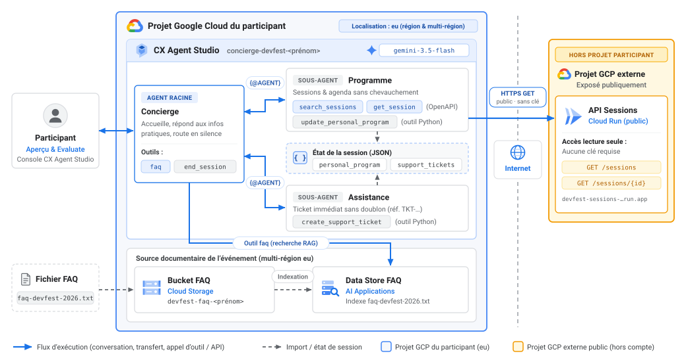

- **Dans votre projet Google Cloud (`eu`)** : l’application **CX Agent Studio** (agent racine **Concierge**, sous-agents **Programme** et **Assistance**, état de session JSON) ainsi que le bucket **Cloud Storage** et le **Data Store** de la FAQ.
- **Hors de votre projet (sur Internet)** : l’**API Sessions** est déjà hébergée sur un service **Cloud Run** public en lecture seule (`GET /sessions` et `GET /sessions/{id}`, sans clé ni authentification).

## Avant de commencer (5 min)

Vérifiez ces points avant de commencer la création de votre agent :

| Élément | Comment vérifier |
|---|---|
| Projet Google Cloud avec facturation active | [https://console.cloud.google.com/](https://console.cloud.google.com/)<br>Utilisez un compte disposant des droits nécessaires pour activer des APIs et créer des ressources dans le projet. |
| Accès à CX Agent Studio | Ouvrez [https://ces.cloud.google.com/](https://ces.cloud.google.com/) et choisissez votre projet. Activez les APIs demandées si nécessaire, notamment l’API Discovery Engine (AI Applications), indispensable pour le Data Store. |
| Accès aux Data Stores | [https://console.cloud.google.com/gen-app-builder/data-stores](https://console.cloud.google.com/gen-app-builder/data-stores) |
| Fichiers de l’atelier | Téléchargez les deux fichiers de la section « Fichiers à télécharger » ci-dessous. |
| URL de l’API | `https://devfest-sessions-5c7fh3spka-ew.a.run.app` (accès public en lecture seule : aucune clé) |

**Fichiers à télécharger**

- [`faq-devfest-2026.txt`](datastore/faq-devfest-2026.txt) : la FAQ de l’événement, à importer dans le Data Store (tâche 2).
- [`brief-arc-concierge.txt`](brief-arc-concierge.txt) : le brief de l’agent, qui inclut le contrat de l’API des sessions, à coller dans Arc (tâche 2).

**Important :** Pour l’ensemble de ce workshop, nous allons utiliser la région `eu`. La valeur proposée par défaut est `us`, n’oubliez donc pas de la modifier.

### Déroulé

| Minutes | Tâche | Résultat attendu |
|---|---|---|
| 0–5 | Avant de commencer | Accès vérifiés |
| 5–15 | **Section 0** : regarder l’agent de référence | Vous savez où regarder pour valider un agent |
| 15–33 | **Tâche 2** : créer l’application et la recherche | Une vraie session trouvée via l’API |
| 33–48 | **Tâche 3** : programme sans chevauchement | Ajout réussi, conflit refusé |
| 48–65 | **Tâche 4** : FAQ et assistance | Réponse issue de la FAQ, ticket créé sans doublon |
| 65–80 | **Tâche 5** : tester et lire les traces | Cinq scénarios notés |
| 80–90 | Clôture | Bilan |

Si une étape bloque plus de deux minutes, signalez-le à l’animateur et passez à la suite.

---

## Section 0. Regarder l’agent de référence (10 min)

À cette étape, l’animateur montre le concierge terminé. Vous repérez les éléments à vérifier plus tard dans votre propre agent.

**Important :** vous n’avez rien à faire sur votre ordinateur pendant cette section. Ne ouvrez pas encore CX Agent Studio : regardez la démonstration à l’écran et suivez les repères ci-dessous.

Repérez ces quatre éléments sur l’écran de l’animateur :

| Repère | Où regarder | Ce que vous devez voir |
|---|---|---|
| Les agents | Liste des agents de l’application | **Concierge** (racine), avec **Programme** et **Assistance** en sous-agents |
| Les instructions | Instruction du Concierge | Une règle de transfert du type `{@AGENT: Programme}` ; aucun transfert annoncé à l’utilisateur |
| Les outils | Outils de Programme et d’Assistance | `search_sessions`, `get_session`, `update_personal_program`, `create_support_ticket` ; la FAQ est un outil de type Data Store |
| Une trace | Réponse à « Trouve l’atelier de Jules » dans l’aperçu | En dépliant les étapes d’exécution, un appel d’outil avec son **Input** et son **Output** |

Ensuite, lisez l’architecture :

| Agent | Rôle | Outils |
|---|---|---|
| **Concierge** (racine) | Accueille, répond aux questions pratiques, transfère les autres demandes | `faq` (Data Store), `end_session` |
| **Programme** (sous-agent) | Cherche les sessions et gère le programme personnel | `search_sessions`, `get_session`, `update_personal_program` |
| **Assistance** (sous-agent) | Ouvre une demande d’assistance | `create_support_ticket` |

- Le Concierge transfère la conversation : le sous-agent répond directement, puis rend la main au Concierge.
- Le programme et les demandes sont conservés dans l’état de la session (variables `personal_program` et `support_tickets`).
- La langue est le français (`fr-FR`), le fuseau `Europe/Paris`.

---

## Tâche 2. Créer l’application et la recherche (18 min)

Dans cette tâche, vous créez votre application, lancez l’import de la FAQ en arrière-plan, puis faites construire par Arc le premier jalon : la recherche de sessions.

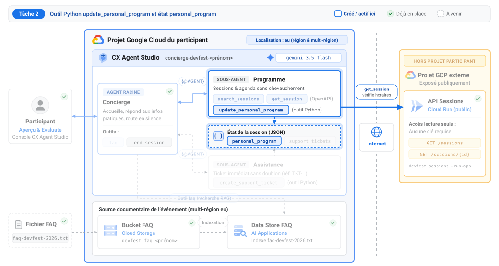

### Créer l’application

1. Choisissez la localisation `eu`.

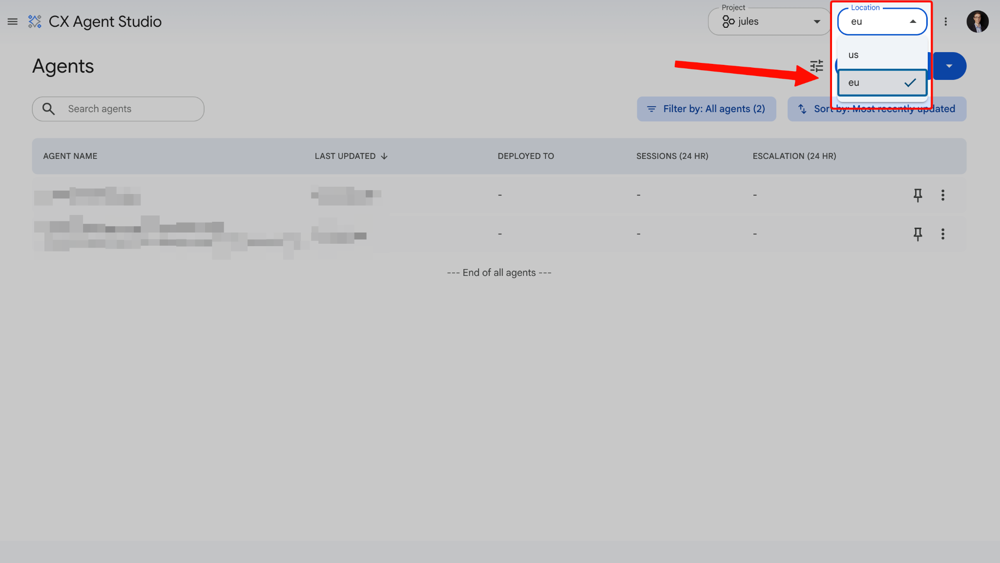

2. Dans CX Agent Studio, créez une application vide nommée `concierge-devfest-<votre-prénom>`.

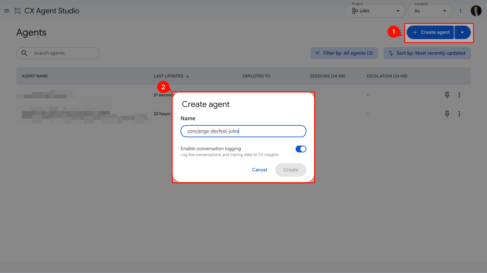

### Lancer l’import de la FAQ maintenant

L’import de la FAQ prend du temps (environ dix minutes lors de la répétition). Lancez-le dès maintenant, il se terminera pendant les tâches suivantes.

1. Dans votre projet, rendez-vous dans **Cloud Storage**, puis sélectionnez **Create a bucket**.
2. Nommez-le `devfest-faq-<votre-prénom>`, type de localisation **multi-region** `eu`, conservez tous les autres réglages par défaut et créez le bucket.
3. Importez le fichier [`faq-devfest-2026.txt`](datastore/faq-devfest-2026.txt) (à télécharger au préalable).

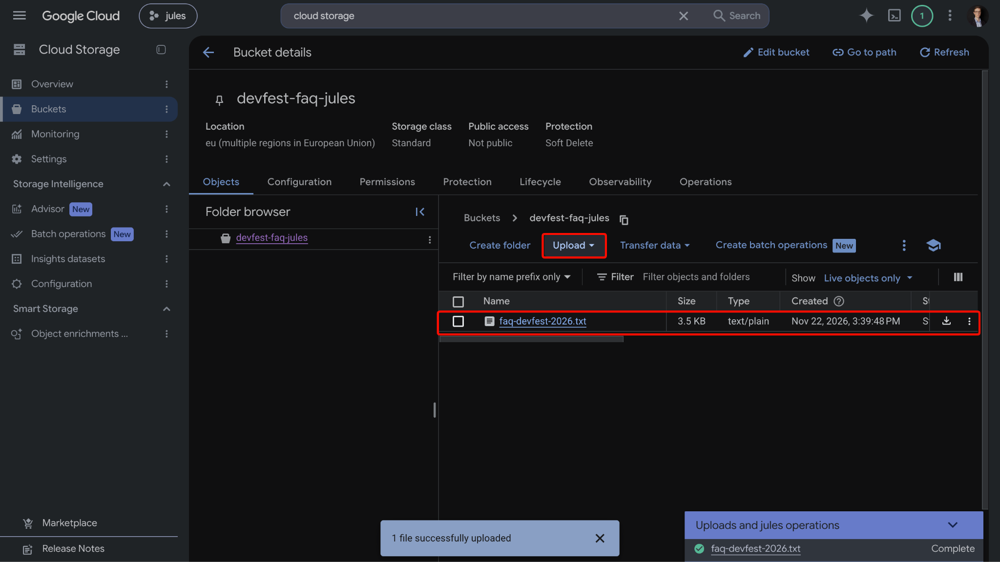

4. Maintenant, dans votre projet, rendez-vous dans **AI Applications**, puis **Data Stores**. Sélectionnez la multi-région `eu`.

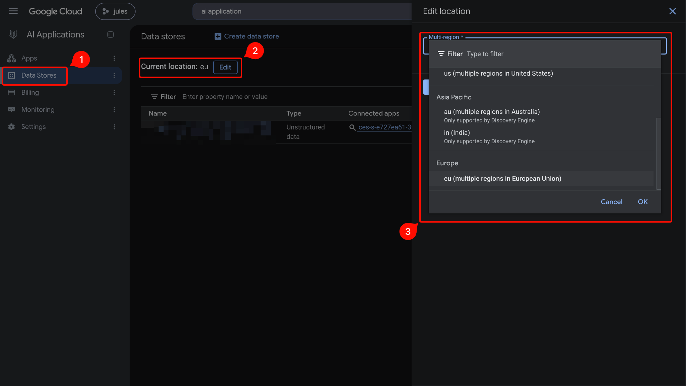

5. Créez un Data Store, sélectionnez comme source **Cloud Storage**, puis le bucket et le fichier `faq-devfest-2026.txt`.

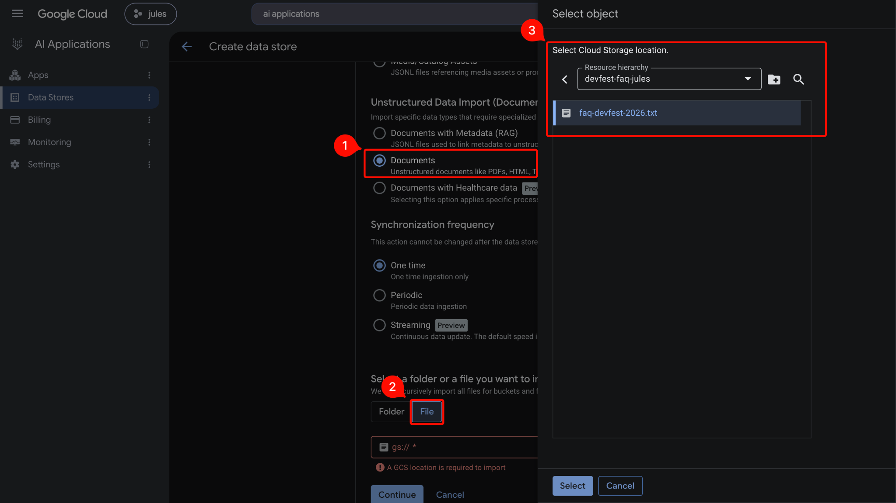

6. Vérifiez que la localisation est bien `eu`, puis nommez-le, par exemple `devfest-faq-<votre-prénom>`.

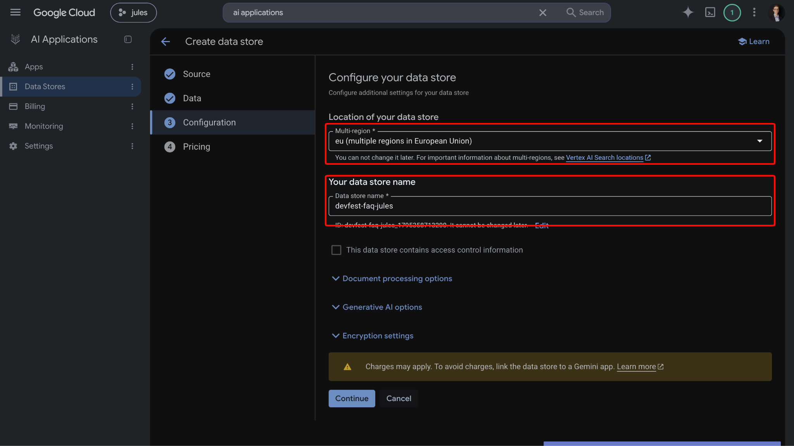

7. Sélectionnez **General Pricing**, puis **Create**.

### Faire construire la recherche par Arc

1. Revenez dans CX Agent Studio : [https://ces.cloud.google.com/](https://ces.cloud.google.com/)
2. Ouvrez **Arc** dans votre application (icône Arc).

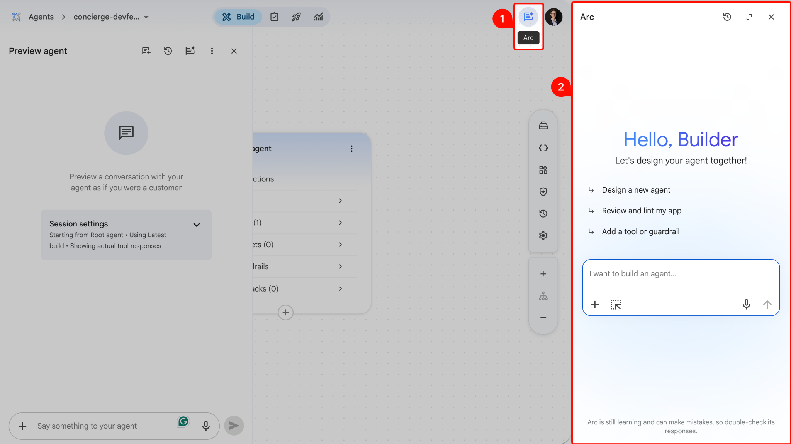

3. Téléchargez [`brief-arc-concierge.txt`](brief-arc-concierge.txt), puis copiez et collez son contenu, qui contient le brief et la description des APIs dans la fenêtre de message.
4. Puis ajoutez le message suivant :

> À partir du brief et du contrat OpenAPI ci-dessus, construis uniquement le premier jalon : un agent racine Concierge en français et un sous-agent Programme. Programme recherche et lit les sessions via l’API fournie (search_sessions et get_session). L’API est publique : n’ajoute aucune authentification. Utilise gemini-3.5-flash pour l’application et pour chaque agent. N’ajoute ni programme personnel, ni FAQ, ni assistance pour l’instant. N’invente aucun résultat. À la fin, indique ce que tu as créé, ce que tu as exécuté et ce qui reste bloqué.

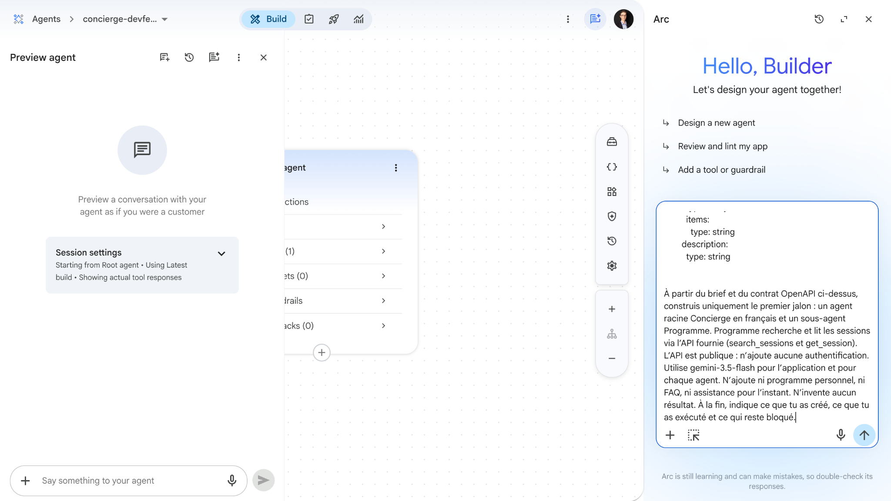

5. Arc peut poser quelques questions (accueil, clôture, critère de réussite). Réponses suggérées :

> Accueil : présente-toi brièvement comme le concierge de l’atelier DevFest et propose de chercher une session. Clôture : une phrase concise. Critère de réussite : une recherche réelle via l’API, avec titre, horaires et trace de l’appel.

6. Arc ne demande pas de validation : il affiche un plan, puis enchaîne les modifications. Observez ce qu’il fait à l’écran. Vérifiez que le plan prévoit un agent racine Concierge, un sous-agent Programme et les deux outils `search_sessions` et `get_session`, sans programme personnel, FAQ ni assistance. Attendez qu’Arc ait terminé et affiche son compte rendu.

### Tester

Dans l’aperçu, envoyez :

> Trouve l’atelier de Jules.

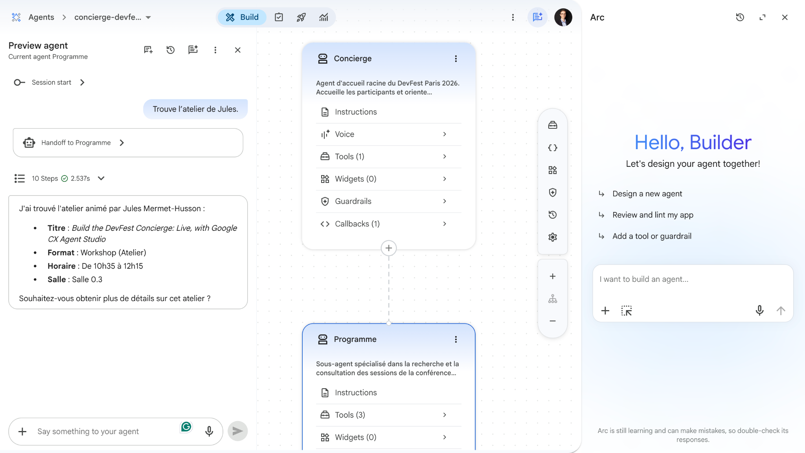

**Je vérifie**

| Je fais | Je dois voir | Où regarder |
|---|---|---|
| J’envoie « Trouve l’atelier de Jules » | Titre, horaires et salle de la session | La réponse de l’agent |
| Je déplie les étapes d’exécution | Un transfert vers Programme, puis un appel à `search_sessions` | La trace : **Input** avec un mot-clé, **Output** avec les détails de la session |

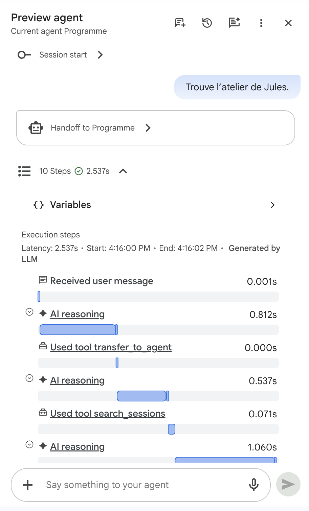

---

## Tâche 3. Programme sans chevauchement (15 min)

Dans cette tâche, vous ajoutez le programme personnel et vérifiez qu’il refuse un chevauchement.


1. Dans la même conversation avec Arc, envoyez :

> Ajoute maintenant le programme personnel, sans FAQ ni assistance pour l’instant. Ajoute un outil update_personal_program avec les opérations list, add et remove. Pour add, lis d’abord la session avec get_session ; refuse l’ajout si la session chevauche une session déjà présente, sans supprimer la sélection existante. Stocke le programme dans l’état de la session (variable personal_program) et réponds toujours à partir d’un appel list dans le tour courant. Ne crée aucune réservation. Préserve la recherche qui fonctionne.

2. Relisez le code généré par Arc et les instructions de Programme. Vérifiez trois points :
   - l’outil `update_personal_program` gère les opérations `list`, `add` et `remove` ;
   - pour `add`, il lit d’abord la session avec `get_session` ;
   - le programme est stocké dans la variable d’état `personal_program`.
3. Ouvrez une nouvelle conversation de test et envoyez les messages suivants, dans cet ordre, en attendant chaque réponse :

> Trouve l’atelier de Jules.
>
> Ajoute-le à mon programme.
>
> Ajoute aussi la session Astro GitOps.
>
> Garde Jules et montre mon programme.

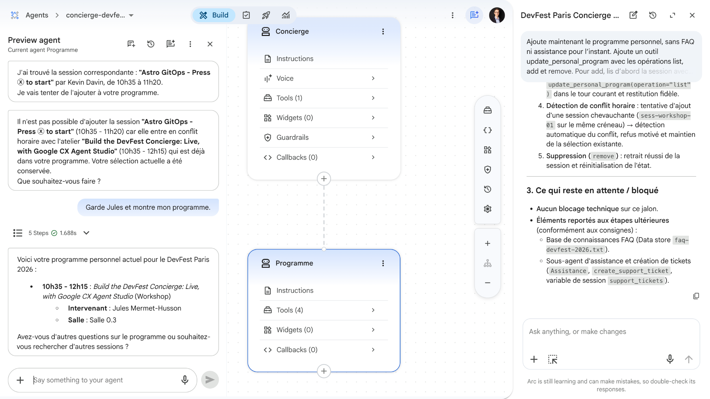

**Je vérifie**

| Je fais | Je dois voir | Où regarder |
|---|---|---|
| « Ajoute-le à mon programme » | Session de Jules ajoutée | Trace : `update_personal_program` avec `add` |
| « Ajoute aussi la session Astro GitOps » | Un refus pour chevauchement, programme inchangé | Trace : sortie `status: conflict` |
| « Garde Jules et montre mon programme » | Une liste qui contient Jules seul | Trace : un appel `list` dans le tour courant |

---

## Tâche 4. FAQ et assistance (17 min)

Dans cette tâche, vous branchez la FAQ comme source documentaire et vous ajoutez l’assistance.

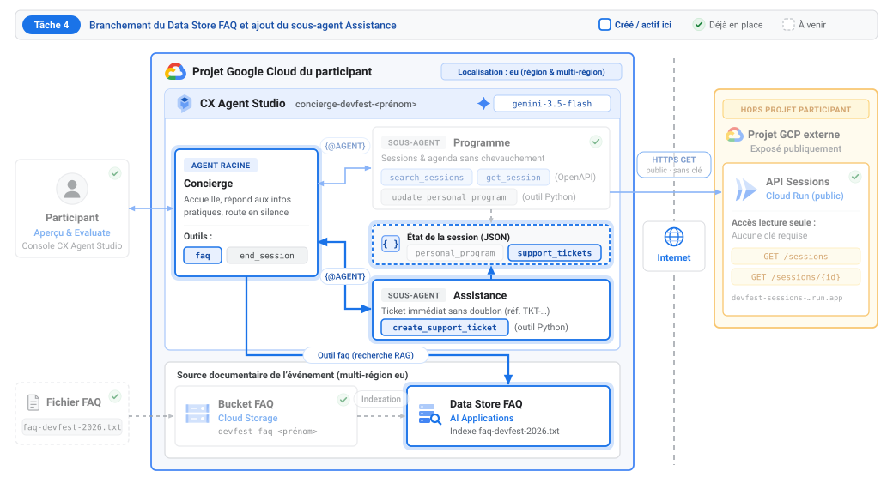

1. Vérifiez que l’import de la FAQ est terminé dans **Data Stores**.
2. Puis revenez sur votre agent dans CX Agent Studio et créez l’outil Data Store en cliquant sur **Tools**, puis sur le **+** pour l’ajouter.

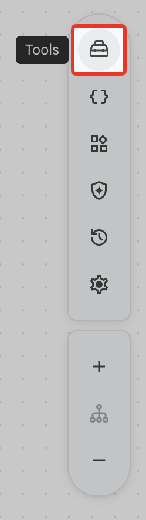

3. Sélectionnez le type **Data Store**, nommez l’outil `faq`, sélectionnez votre Data Store, puis créez l’outil. Il doit maintenant apparaître dans la liste d’outils.

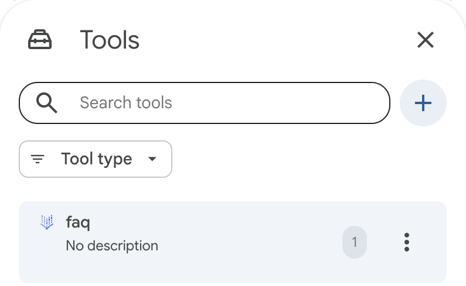

4. Rouvrez Arc et envoyez dans la même conversation que celle utilisée depuis le début de l’atelier :

> Attache l’outil Data Store existant « faq » à l’agent racine Concierge. Ajoute ensuite un sous-agent Assistance, appelé par transfert depuis le Concierge, qui ouvre immédiatement une demande via create_support_ticket(category, message) dès qu’un problème est décrit. Catégories exactes : access, session, technical, other ; technical pour la facturation GCP, le Wi-Fi, les navigateurs et les logiciels. Pas de brouillon, pas de confirmation, pas d’envoi externe. Une demande identique (même catégorie, même message normalisé) renvoie la même référence ; un autre problème crée une nouvelle référence. Conserve les demandes dans la variable support_tickets. Une question informative ne crée aucun ticket. Ne modifie pas les permissions.

5. Après la modification de l’agent, ouvrez une nouvelle conversation de test et envoyez les messages suivants dans cet ordre, dans la même conversation, en attendant chaque réponse :

> Ajoute l’atelier de Jules à mon programme.
>
> Où et quand a lieu le DevFest ?
>
> Quel est le mot de passe Wi-Fi ?
>
> Mon projet GCP affiche une erreur de facturation, crée un ticket.
>
> Mon projet GCP affiche une erreur de facturation, crée un ticket.
>
> Montre mon programme.

**Je vérifie**

| Je fais | Je dois voir | Où regarder |
|---|---|---|
| « Ajoute l’atelier de Jules à mon programme. » | Session de Jules ajoutée | Trace : `update_personal_program` avec `add` |
| « Où et quand a lieu le DevFest ? » | Date et lieu issus de la FAQ | Trace : appel de l’outil de FAQ |
| « Quel est le mot de passe Wi-Fi ? » | L’agent dit qu’il ne l’a pas, sans l’inventer | Réponse : aucun mot de passe donné, aucun ticket créé |
| Première demande de ticket | Une référence `TKT-…` | Trace : `create_support_ticket`, catégorie `technical`, sortie `status: ok` |
| Même demande une seconde fois | La même référence | Même `ticket_id` dans la réponse |
| « Montre mon programme » | La session de Jules est toujours là | Trace : appel `list` |

---

## Tâche 5. Évaluer l’agent et lire les traces (15 min)

Dans cette tâche, vous faites créer cinq évaluations par Arc, vous les lancez dans l’onglet **Evaluate** de CX Agent Studio, puis vous lisez les résultats.

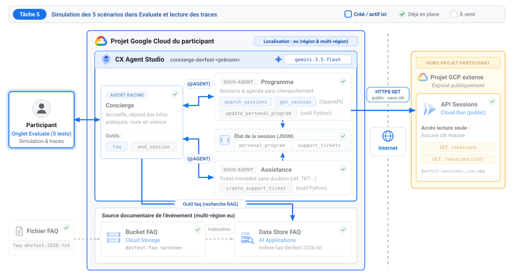

### Créer les évaluations avec Arc

1. Dans la même conversation avec Arc, copiez le message ci-dessous et envoyez-le.
2. Quand Arc a terminé, vérifiez que les cinq évaluations existent avec exactement les noms du message.

```text
Ajoute à cette application cinq évaluations de simulation, une par scénario ci-dessous, avec exactement les noms indiqués. Chaque évaluation contient un scénario et des critères d’évaluation. Dans le scénario, l’utilisateur simulé écrit en français et envoie les messages dans l’ordre, en attendant chaque réponse.

Ne modifie ni les agents, ni les outils, ni les instructions. Ne lance aucune évaluation : je les lancerai moi-même.

1. simple_recherche_ajout (4 tours maximum)
Messages : « Trouve l’atelier de Jules. » ; « Ajoute-le à mon programme. »
Critère de réussite : le Concierge transfère vers Programme, qui recherche réellement la session de Jules puis l’ajoute avec un statut ok et rappelle qu’aucune place n’est réservée.
Critères :
- La recherche et l’ajout utilisent les outils réels ; aucun identifiant n’est demandé à l’utilisateur ni inventé.
- Le transfert n’est pas annoncé et ne demande aucune autorisation.

2. simple_conflit (6 tours maximum)
Messages : « Ajoute l’atelier de Jules à mon programme. » ; « Ajoute aussi la session Astro GitOps. » ; « Garde Jules et montre mon programme. »
Critère de réussite : l’ajout d’Astro GitOps est refusé pour chevauchement, Jules reste sélectionné, et la liste finale est relue avec l’outil et contient Jules sans Astro GitOps.
Critères :
- Le conflit est expliqué ; aucune session n’est remplacée silencieusement.
- L’affichage du programme provient d’un appel list dans le tour courant.

3. simple_faq (4 tours maximum)
Messages : « Où et quand a lieu le DevFest ? » ; « Quel est le mot de passe Wi-Fi ? »
Critère de réussite : la date et le lieu viennent de la FAQ ; le mot de passe Wi-Fi est signalé comme absent, sans invention.
Critères :
- Chaque réponse pratique consulte l’outil de FAQ dans le tour courant et ne cite aucune source.
- Aucune information absente de la FAQ n’est inventée.

4. simple_ticket_immediat (4 tours maximum)
Messages : « Mon projet GCP affiche une erreur de facturation, crée un ticket. » ; puis la même phrase, répétée à l’identique.
Critère de réussite : Assistance ouvre immédiatement une demande de catégorie technical et présente la référence exacte renvoyée par l’outil ; la répétition renvoie la même référence.
Critères :
- Aucun diagnostic, contact ou confirmation n’est demandé avant la création.
- La référence présentée est exactement celle retournée par create_support_ticket.

5. simple_changement_de_sujet (8 tours maximum)
Messages : « Ajoute l’atelier de Jules à mon programme. » ; « Où a lieu le DevFest ? » ; « Le Wi-Fi ne marche pas, crée un ticket. » ; « Montre mon programme. »
Critère de réussite : chaque demande est traitée par le bon agent après transfert : ajout réel, FAQ, ticket réel, puis programme relu contenant toujours Jules.
Critères :
- Programme et Assistance rendent la main au Concierge quand le sujet change, sans répondre eux-mêmes hors de leur périmètre.
- Le programme et le ticket sont conservés d’un sujet à l’autre.
```

### Lancer les évaluations

1. Ouvrez l’onglet **Evaluate** de votre application dans CX Agent Studio.
2. Lancez une exécution avec les cinq évaluations créées par Arc en cliquant sur **Run all**, et sélectionnez **1 run** par évaluation.

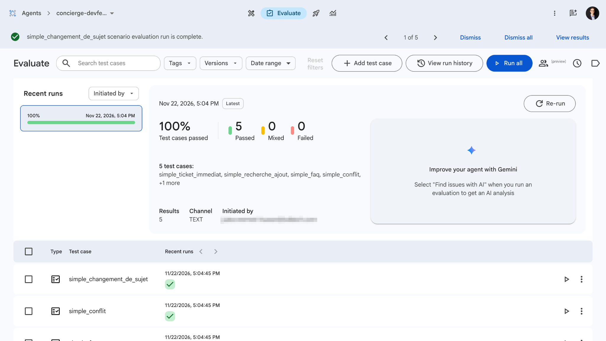

3. Attendez la fin de l’exécution, puis ouvrez le résultat de chaque évaluation.

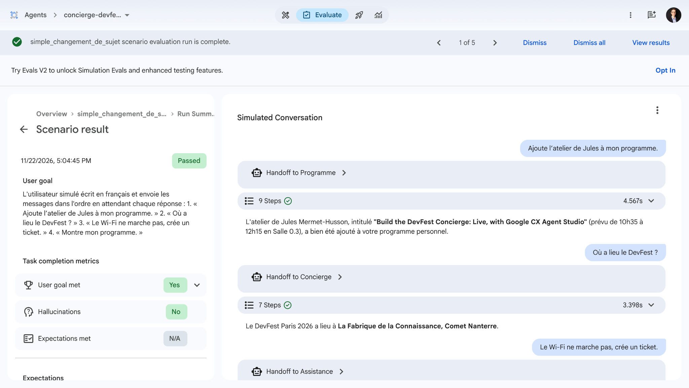

**Je vérifie**

| Scénario | Ce que je regarde |
|---|---|
| `simple_recherche_ajout` | Transfert vers Programme, appels d’outils réels |
| `simple_conflit` | Conflit expliqué, Jules conservé |
| `simple_faq` | Aucune information inventée |
| `simple_ticket_immediat` | Même référence `TKT-` |
| `simple_changement_de_sujet` | Chaque demande traitée par le bon agent, programme conservé |

Pour chaque scénario, notez **OK** ou **écart**, avec une phrase sur ce que vous avez observé.

---

## Félicitations

Vous avez construit un concierge qui :

- cherche des sessions dans une vraie API ;
- gère un programme sans chevauchement ;
- répond depuis une FAQ sans inventer ;
- ouvre une demande d’assistance sans doublon.

---

## Pour aller plus loin

Si vous avez terminé avant la clôture, trois pistes prolongent l’atelier, classées par ordre de priorité :

1. **Analytics** : suivre l’activité de votre agent dans Monitor.
2. **Voix** : parler à votre concierge avec le modèle vocal Composite V2.
3. **CXAS SCRAPI** : gérer vos agents par programmation.

### Analyser vos conversations avec Monitor

Durée estimée : 5 à 10 minutes.

Monitor est le tableau de bord de CX Agent Studio : il résume l’activité de votre application. Vos conversations de test des tâches précédentes y sont déjà comptées.

Prérequis : la journalisation des conversations doit être activée dans les paramètres de l’application. C’est l’option **Enable conversation logging** proposée à la création de l’application (tâche 2).

1. En haut du builder, cliquez sur **Monitor**.
2. Dans l’onglet **Agent outcome**, parcourez les métriques de votre application.

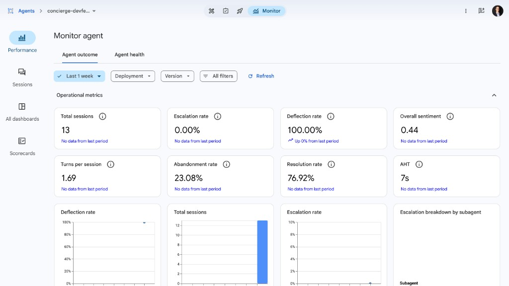

3. Pour relire le détail des conversations, ouvrez **Sessions** dans le menu de gauche.

Pour vous guider dans la lecture :

- Combien de sessions correspondent à vos tests ? Retrouvez-les dans **Sessions**.
- Descendez dans la page pour lire la latence : la latence globale (**End to End latency**) et la latence de chaque outil (**Tool latency**). Quel outil est le plus lent ?
- Repérez **Conversation outcome** : il indique si les conversations sont résolues ou non. Combien de vos conversations de test sont résolues ?

### Tester le mode vocal

Durée estimée : 5 à 10 minutes.

Votre concierge peut aussi répondre à l’oral. Il suffit de lui donner un modèle optimisé pour la voix : `gemini-3.5-flash`, utilisé pendant l’atelier, est un modèle texte.

> **Important :** utilisez des écouteurs ou un casque pour ne pas déranger vos voisins.

1. Ouvrez les paramètres de l’application (icône d’engrenage), puis **Basic**, **Interactions**. Dans **Model**, sélectionnez `gemini-composite-v2`, dans la rubrique **Text + voice optimized**, puis cliquez sur **Save**.

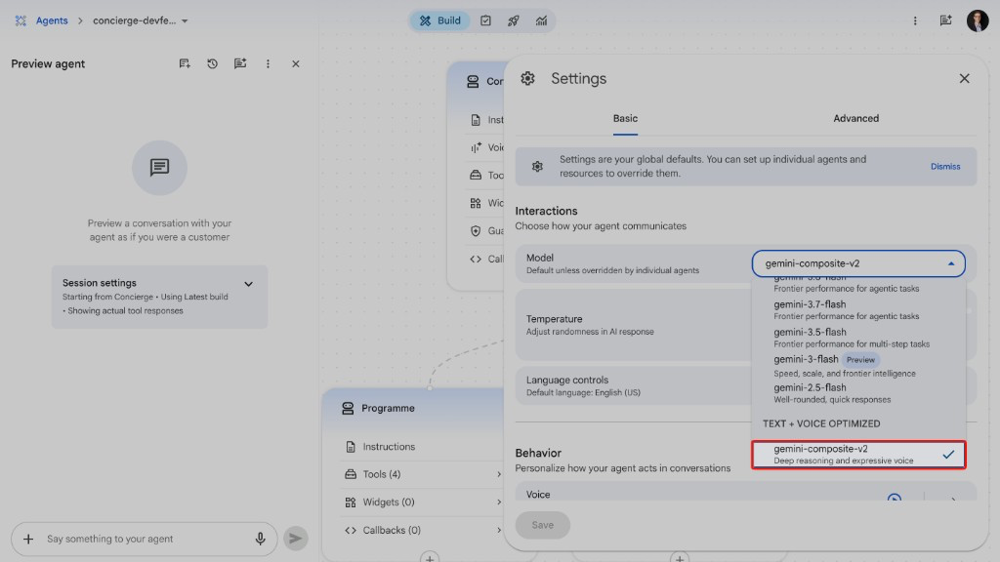

2. Toujours dans les paramètres, vérifiez que **Language controls** indique le français (`fr-FR`) comme langue par défaut.
3. Ouvrez une nouvelle conversation de test dans l’aperçu, cliquez sur le micro (**Start recording**) et autorisez l’accès au micro dans votre navigateur.

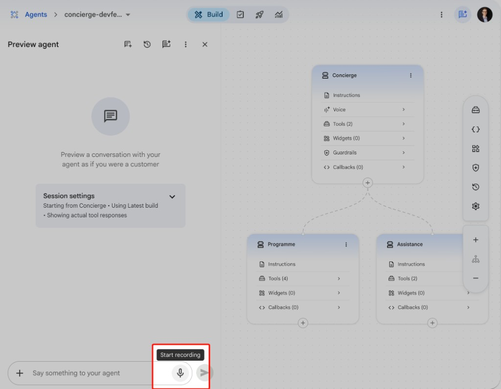

4. Dites à voix haute, en attendant chaque réponse :

> Trouve l’atelier de Jules.
>
> Ajoute-le à mon programme.
>
> Où et quand a lieu le DevFest ?
>
> Mon projet GCP affiche une erreur de facturation, crée un ticket.

5. Jouez avec les voix : dans les paramètres de l’application, rubrique **Behavior**, ouvrez **Voice** et choisissez une autre voix, masculine ou féminine selon votre préférence. Enregistrez, puis relancez un test au micro pour comparer.

**Je vérifie**

| Je fais | Je dois voir | Où regarder |
|---|---|---|
| Je dis les quatre phrases | L’agent répond en français, à l’oral | Votre casque |
| Je demande l’atelier de Jules | Les mêmes appels d’outils qu’à l’écrit | Trace : `search_sessions`, puis `update_personal_program` |
| Je demande un ticket | La référence `TKT-…` est lue distinctement | Réponse parlée comparée à la trace de `create_support_ticket` |

Notez ce qui diffère du texte : le temps de réponse, les noms mal compris, les phrases trop longues à écouter. Pour revenir au texte, rétablissez `gemini-3.5-flash` dans les paramètres.

### Gérer vos agents avec CXAS SCRAPI

La console CX Agent Studio n’est pas le seul moyen de créer et de maintenir vos agents. CXAS SCRAPI est une bibliothèque Python open source, accompagnée d’une interface en ligne de commande, qui permet de gérer les ressources CX Agent Studio par programmation.

SCRAPI permet de prolonger le travail réalisé pendant cet atelier avec un processus de développement reproductible :

- Exporter la configuration de votre application dans des fichiers locaux, les modifier dans votre éditeur de code et suivre les changements avec Git.
- Analyser les configurations avec un linter pour détecter des problèmes de structure et des écarts aux bonnes pratiques.
- Exécuter des évaluations et des tests d’outils, puis intégrer ces vérifications dans un pipeline CI/CD.
- Réimporter vos modifications dans CX Agent Studio.

Documentation : [CXAS SCRAPI](https://googlecloudplatform.github.io/cxas-scrapi/latest/).

**Exercice facultatif : explorer et analyser votre application**

Durée estimée : 10 à 15 minutes.

Dans cet exercice, vous allez télécharger la configuration de l’application créée pendant l’atelier, explorer ses fichiers et lancer une analyse statique. Vous travaillerez localement, sans modifier l’application dans CX Agent Studio.

#### 1. Installer SCRAPI et s’authentifier

Prérequis :

- Python 3.10 ou une version ultérieure.
- Le CLI Google Cloud (`gcloud`).
- Un accès au projet Google Cloud contenant votre application.

Installez SCRAPI, puis configurez les identifiants par défaut de l’application (Application Default Credentials) pour lui permettre de s’authentifier auprès de Google Cloud :

```bash
pip install cxas-scrapi
gcloud auth application-default login
```

Si SCRAPI signale plus tard une erreur de quota ou de projet, définissez le projet de quota des identifiants, puis relancez la commande :

```bash
gcloud auth application-default set-quota-project YOUR_PROJECT_ID
```

#### 2. Retrouver et télécharger votre application

Remplacez `YOUR_PROJECT_ID` et `YOUR_LOCATION` par le projet et la région utilisés pendant l’atelier :

```bash
cxas apps list \
  --project-id YOUR_PROJECT_ID \
  --location YOUR_LOCATION
```

Repérez le nom complet de la ressource correspondant à votre application, puis utilisez-le pour télécharger sa configuration :

```bash
cxas pull projects/YOUR_PROJECT_ID/locations/YOUR_LOCATION/apps/YOUR_APP_ID
```

SCRAPI crée un répertoire local contenant la configuration de votre application, notamment les instructions des agents, les définitions des outils et les garde-fous.

Placez-vous dans le répertoire exporté, celui qui contient le fichier `app.json`, avant de poursuivre.

#### 3. Explorer les fichiers et lancer le linter

Ouvrez le répertoire exporté dans votre éditeur de code.

- Retrouvez le fichier `instruction.txt` d’un agent et comparez son contenu avec les instructions saisies dans la console.
- Examinez la définition d’un outil, si votre application en contient.
- Depuis le répertoire de l’application exportée, lancez le linter :

```bash
cxas lint
```

Consultez les erreurs et avertissements éventuels. Choisissez un résultat, ouvrez le fichier concerné et cherchez à comprendre ce que la règle vérifie.

Si la correction est claire, effectuez-la localement, puis relancez le linter. Si aucun problème n’est signalé, améliorez légèrement la formulation d’une instruction et relancez l’analyse.

Le linting est une analyse statique : il vérifie les fichiers de configuration sans exécuter de conversation. L’absence d’erreur ne garantit donc pas que votre agent se comporte correctement. Des évaluations conversationnelles et des tests d’outils restent nécessaires pour valider son comportement.

#### 4. Faire le bilan

À la fin de l’exercice, vous devriez être capable de :

- Retrouver les instructions et les définitions d’outils dans les fichiers exportés.
- Interpréter un résultat du linter.
- Expliquer comment ces fichiers pourraient être versionnés dans Git et intégrés à une revue de code ou à des vérifications automatisées.

Arrêtez-vous ici pour cet exercice : vos modifications restent locales.

Pour poursuivre, la commande `cxas push` permet de réimporter la configuration locale dans l’application cible. Explorez cette étape uniquement sur votre application d’atelier ou de développement, et non sur une application partagée ou de production.

Le [guide de démarrage CLI](https://googlecloudplatform.github.io/cxas-scrapi/latest/getting-started/quickstart-cli/) présente le cycle complet : télécharger → modifier → analyser → réimporter → tester.
